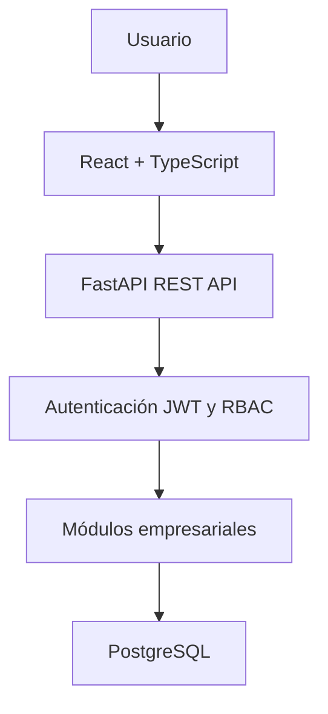

# EnterpriseFlow


## Descripción

EnterpriseFlow es una aplicación web Full Stack de gestión
empresarial diseñada para centralizar la administración de
empleados, proyectos, tareas y usuarios mediante una
plataforma moderna, modular y responsive.

El sistema integra una API REST desarrollada con FastAPI,
una base de datos relacional PostgreSQL y una interfaz
interactiva construida con React y TypeScript.

## Funcionalidades

### Dashboard

- Indicadores de rendimiento empresarial.
- Total de empleados, proyectos y tareas.
- Visualización de estadísticas mediante gráficos.
- Porcentaje de tareas completadas.
- Seguimiento del progreso general.

### Gestión de empleados

- Creación, consulta, edición y eliminación.
- Búsqueda por nombre y puesto.
- Asignación a proyectos y tareas.
- Protección de registros relacionados.

### Gestión de proyectos

- Administración de proyectos empresariales.
- Asignación de responsables.
- Control de estados y fechas de entrega.
- Búsqueda y filtrado de proyectos.

### Gestión de tareas

- Tablero Kanban.
- Clasificación por estado y prioridad.
- Asignación de empleados y proyectos.
- Seguimiento de fechas de entrega.
- Búsqueda y filtros dinámicos.

### Autenticación y seguridad

- Inicio de sesión mediante JWT.
- Contraseñas protegidas con Argon2.
- Control de acceso basado en roles (RBAC).
- Protección de endpoints.
- Persistencia de sesión durante la navegación.
- Cierre automático de sesiones expiradas.

### Administración de usuarios

- Registro de nuevos usuarios.
- Gestión de roles y permisos.
- Activación y desactivación de cuentas.
- Cambio de contraseña.
- Administración del perfil.

## Tecnologías utilizadas

| Capa | Tecnologías |
|---|---|
| Frontend | React, TypeScript, Vite |
| Diseño | Tailwind CSS, Lucide React |
| Visualización | Recharts |
| Comunicación HTTP | Axios |
| Backend | Python, FastAPI, Uvicorn |
| Base de datos | PostgreSQL, Psycopg |
| Validación | Pydantic |
| Seguridad | JWT, Argon2, RBAC |
| Control de versiones | Git, GitHub |
| Gestión de dependencias | uv, npm |

## Arquitectura



La aplicación utiliza una arquitectura cliente-servidor
con separación entre la interfaz de usuario, la lógica
del backend y la persistencia de datos.

## Estructura del proyecto

```text
EnterpriseFlow/
├── core/
│   ├── dependencies.py
│   ├── exceptions.py
│   └── security.py
├── database/
│   ├── conexion.py
│   └── schema.sql
├── models/
│   ├── empleado.py
│   ├── proyecto.py
│   ├── tarea.py
│   └── usuario.py
├── routes/
│   ├── auth.py
│   ├── dashboard.py
│   ├── empleados.py
│   ├── proyectos.py
│   └── tareas.py
├── scripts/
│   └── crear_admin.py
├── frontend/
│   ├── public/
│   ├── src/
│   │   ├── assets/
│   │   ├── components/
│   │   ├── pages/
│   │   ├── services/
│   │   ├── App.tsx
│   │   └── index.css
│   ├── package.json
│   └── vite.config.ts
├── .env.example
├── .gitignore
├── main.py
├── requirements.txt
└── README.md
```

## Roles y permisos

| Funcionalidad | Administrador | Usuario |
|---|---|---|
| Consultar dashboard | Sí | Sí |
| Consultar empleados | Sí | Sí |
| Consultar proyectos | Sí | Sí |
| Consultar tareas | Sí | Sí |
| Crear registros | Sí | No |
| Editar registros | Sí | No |
| Eliminar registros | Sí | No |
| Administrar usuarios | Sí | No |
| Cambiar contraseña propia | Sí | Sí |

## Endpoints principales

| Método | Endpoint | Descripción |
|---|---|---|
| GET | /dashboard | Indicadores empresariales |
| GET | /empleados | Listar empleados |
| POST | /empleados | Crear empleado |
| PUT | /empleados/{id} | Actualizar empleado |
| DELETE | /empleados/{id} | Eliminar empleado |
| GET | /proyectos | Listar proyectos |
| POST | /proyectos | Crear proyecto |
| PUT | /proyectos/{id} | Actualizar proyecto |
| DELETE | /proyectos/{id} | Eliminar proyecto |
| GET | /tareas | Listar tareas |
| POST | /tareas | Crear tarea |
| PUT | /tareas/{id} | Actualizar tarea |
| DELETE | /tareas/{id} | Eliminar tarea |
| POST | /auth/login | Iniciar sesión |
| POST | /auth/registro | Registrar usuario |
| GET | /auth/me | Consultar perfil |
| GET | /auth/usuarios | Listar usuarios |
| PUT | /auth/usuarios/{id}/rol | Cambiar rol |
| PUT | /auth/usuarios/{id}/estado | Cambiar estado |
| PUT | /auth/password | Cambiar contraseña |

## Instalación local

### Requisitos

- Python 3.14
- PostgreSQL
- Node.js compatible con la versión de Vite utilizada
- npm
- uv
- Git

### 1. Clonar el repositorio

```bash
git clone https://github.com/Brayande21/EnterpriseFlow.git
cd EnterpriseFlow
```

### 2. Configurar el entorno virtual

```bash
uv venv --python 3.14
```

Activar el entorno en Windows:

```powershell
.\.venv\Scripts\Activate.ps1
```

Instalar las dependencias:

```bash
uv pip install -r requirements.txt
```

### 3. Configurar las variables de entorno

Crear un archivo `.env` utilizando `.env.example`
como plantilla.

```env
DB_HOST=localhost
DB_PORT=5432
DB_NAME=enterpriseflow_db
DB_USER=postgres
DB_PASSWORD=your_database_password

JWT_SECRET_KEY=your_secret_key
JWT_ALGORITHM=HS256
JWT_EXPIRATION_MINUTES=60
```

Generar una clave JWT segura:

```bash
python -c "import secrets; print(secrets.token_hex(32))"
```

Sustituir los valores de ejemplo por las credenciales
correspondientes y la clave generada.

### 4. Configurar PostgreSQL

Crear una base de datos llamada `enterpriseflow_db`
y ejecutar el contenido de:

```text
database/schema.sql
```

El esquema puede ejecutarse mediante pgAdmin o psql.

### 5. Crear el primer administrador

Desde la raíz del proyecto:

```bash
python -m scripts.crear_admin
```

Introducir el nombre, correo electrónico y contraseña.

### 6. Iniciar el backend

```bash
python -m uvicorn main:app --reload
```

API disponible en:

http://127.0.0.1:8000

Documentación Swagger:

http://127.0.0.1:8000/docs

Documentación ReDoc:

http://127.0.0.1:8000/redoc

### 7. Iniciar el frontend

Abrir una segunda terminal:

```bash
cd frontend
npm ci
npm run dev
```

Aplicación disponible en:

http://localhost:5173

### 8. Compilar el frontend

```bash
npm run build
```

Los archivos compilados se generan en `frontend/dist`.

## Seguridad e integridad

- Consultas SQL parametrizadas.
- Credenciales mediante variables de entorno.
- Hash de contraseñas con Argon2.
- Autenticación mediante tokens JWT.
- Autorización basada en roles.
- Validación de datos mediante Pydantic.
- Integridad referencial mediante claves foráneas.
- Manejo centralizado de errores de base de datos.
- Protección contra eliminación de registros relacionados.

## Rendimiento

EnterpriseFlow implementa carga diferida de módulos
mediante React Lazy y Suspense.

Resultados de la compilación local:

| Indicador | Antes | Después |
|---|---:|---:|
| JavaScript principal | 726.08 kB | 299.59 kB |
| Tamaño comprimido | 213.07 kB | 97.32 kB |
| Advertencias de tamaño | 1 | 0 |

La optimización redujo aproximadamente un 58.74%
el tamaño del archivo JavaScript principal.

Los módulos se descargan bajo demanda, reduciendo
la carga inicial de la aplicación.

## Diseño responsive

La interfaz se adapta a diferentes tamaños de pantalla:

- Computadoras de escritorio.
- Laptops.
- Tabletas.
- Dispositivos móviles.

Incluye navegación lateral adaptable, componentes
responsive y una interfaz visual consistente.

## Roadmap

- [x] Arquitectura modular del backend.
- [x] Integración con PostgreSQL.
- [x] Gestión de empleados.
- [x] Gestión de proyectos.
- [x] Gestión de tareas.
- [x] Dashboard interactivo.
- [x] Manejo centralizado de errores de base de datos.
- [x] Autenticación JWT.
- [x] Roles y permisos.
- [x] Frontend con React y TypeScript.
- [x] Administración de usuarios.
- [x] Diseño responsive.
- [x] Optimización mediante Lazy Loading.
- [x] Esquema de base de datos.
- [x] Documentación de instalación.
- [ ] Pruebas automatizadas.
- [ ] Despliegue en la nube.
- [ ] Integración continua CI/CD.
- [ ] Contenedores Docker.

## Estado del proyecto

MVP Full Stack en desarrollo activo, con compilación
del frontend verificada y despliegue público pendiente.

EnterpriseFlow es un proyecto de portafolio profesional
orientado al desarrollo de software, gestión empresarial,
arquitectura de aplicaciones web y seguridad informática.

## Autor

**Brayan Rivera**

Estudiante de término de Ingeniería en Sistemas.

GitHub: https://github.com/Brayande21